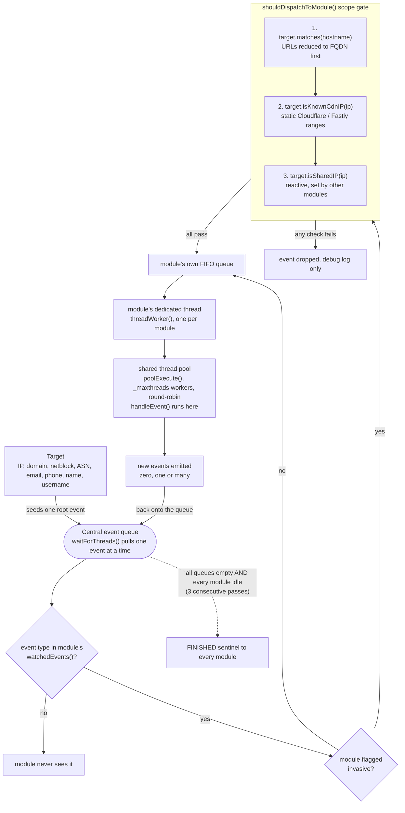
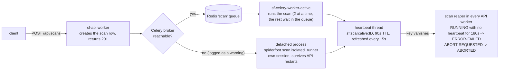
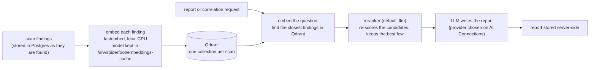

# braedach/spiderfoot — hardened fork

An internal-use fork of [poppopjmp/spiderfoot](https://github.com/poppopjmp/spiderfoot) (the microservices SpiderFoot, v6.1.0), kept public for licence reasons. It fixes bugs in the scanning and AI-report pipeline, replaces the build and deployment with a hardened, scanned, reproducible one, and is run by its maintainer for authorised OSINT and security testing.

**For the actual project — documentation, issues, general use — go to [poppopjmp/spiderfoot](https://github.com/poppopjmp/spiderfoot).** The one upstream PR ([#393](https://github.com/poppopjmp/spiderfoot/pull/393)) was closed unmerged: it had grown to 53 files mixing fork-specific infrastructure with genuine fixes, which is not reviewable as a single PR.

## Current state

**Honest status.** The upstream source and its design have a great many problems, and this fork exists to work through them. Most of the effort is going into three things, in this order of priority:

1. **Staying in scope.** An OSINT tool that scans things the operator is not authorised to touch is worse than no tool. Active (invasive) modules must never act outside the target's own scope, even when discovery data points elsewhere (shared CDN edges, netblock expansion, third-party hosts).
2. **Performance, by removing bottlenecks.** Long scans, stalls and silently dead scans have each traced back to a design flaw (a thread pool shared by every module, unbounded waits on raw threads, scans running inside processes that get killed), not to bad luck. Each one found is fixed at the cause, with a regression test.
3. **Accuracy of the intelligence gained.** Fewer false positives, fewer silently failing modules, and results that can be trusted: broken modules are found by test rather than by accident in log noise.

Expect this to keep changing. Bugs are still being found, mostly old ones that only become visible once a scan is validated live rather than just unit-tested, and the build tags reflect that.

- **Builds:** `v6.1.0-bd.1-rc.36` is the current release candidate, being deployed and validated. `rc.34` was the last build validated live (a 30 minute soak with the dashboard open and six scans). `rc.35` and later are a breaking change for an existing stack: see [`UPGRADING.md`](UPGRADING.md). Do not run `rc.32` or `rc.33` (database connection leak). Every build passes the scan gate on all 5 images (Trivy and `npm audit`). No non-`rc` release has been cut yet.
- **Scope guard:** invasive modules are gated three ways before dispatch (see [How a scan flows](#how-a-scan-flows)): the target must match, the address must not sit in a published Cloudflare or Fastly range, and it must not have been proven shared by another module. Validated live against phone, email, name, domain and IP targets. ASN is the one target type not yet explicitly exercised.
- **Scan execution:** scans no longer run inside API workers, and a scan whose process dies is detected and marked failed instead of staying `RUNNING` forever (see [Where a scan executes](#where-a-scan-executes)).
- **Module catalog:** every module's `setup()` is exercised by a catalog-wide test, because modules that fail to load were previously invisible. Key-free scan profiles exist for phone-number, email-address and person-name targets, and each has been run end to end on a live stack. Dead and superseded modules have been removed.
- **Dependencies and base images:** every Dependabot alert has been fixed and none are currently waived (see below).
- **Tag scheme:** `v<upstream base>-bd.<N>` for a release, `-rc.<M>` for a test build. An `-rc` tag never moves `:latest`.
- **Never push straight to `main`.** Work happens on a branch, goes through a pull request, and is tested as a release candidate before release.

## What is different from upstream

**Build and supply chain** (details in [`deploy/README.md`](deploy/README.md))
- Fork-owned Dockerfiles. Base images pinned by digest; Python dependencies hash-locked and installed with `--require-hashes`; every tool pinned by version and checksum. Rebuilding a tag gives the same image.
- A **14-day cool-down** on individually maintained software, with named, written exceptions for published security fixes. Official OS base images are exempt and refreshed deliberately.
- A **scan gate** that blocks a push: Trivy fails the build on any fixable critical or high vulnerability or unallowed secret, Grype cross-checks, and `npm audit` covers the frontend's bundled dependencies (which the container scanner cannot see). Accepted findings live in `deploy/trivyignore.txt` with a justification; it is currently empty.
- Images are scannable (the package list is kept, the package managers are removed), and unused binaries are removed rather than waited on.
- The active-scanner image builds its Go tools from source with their vulnerable dependencies raised, and drops tools whose own dependencies could not be fixed.
- Builds run on a dedicated build host with `deploy/publish.sh`; production only ever pulls the published images. `publish.sh` reads the build token from one root-only file, removes its own project's local images before a build and on any exit, and refuses to start with under 12 GB free.

**Scanning and correctness fixes**
- **Correlation rules** were never loaded by the API, so no scan produced correlation results; they now load from the filesystem, verified end to end on a real scan.
- **Tool modules:** five tool modules (gobuster, testssl.sh, whatweb, wafw00f, snallygaster) had no binary path configured anywhere, and gobuster had no default wordlist; both now default to the paths baked into the image. A single-page app's catch-all `200` no longer turns every wordlist entry into a hit (`ffuf` auto-calibration, a soft-404 probe for gobuster). `naabu`, `dnsx`, `httpx` and the spider now work against internal hostnames and non-default ports.
- **Core URL helpers** (`urlBaseUrl`, `urlRelativeToAbsolute`) were dropping explicit ports and mangling `scheme://`, corrupting every link a crawl discovered.
- **Scan engine and API:** the scan-progress API returned 404 for every scan; the "modules running" count was always 0 because the engine's own running-module check was blind to every module; the export endpoints crashed or silently returned nothing; configuration saved through one API worker was lost or overwritten by another (saves now write only the keys that changed, and each worker refreshes its copy from the database).
- **Scope escape:** active modules followed discovery data onto shared infrastructure (a target's own subdomain resolving to a Cloudflare or Fastly edge serving unrelated tenants), and the strict-scope check rejected every full-URL event, which silently stopped five web-fuzzing tool modules from ever running. Both fixed.
- **Silent module failures:** seven modules' own `_maxthreads` option was always overwritten by the global setting of the same name; four modules had a `setup()` signature the engine could not call; eight modules could hang an entire scan forever on one unresponsive host, with no error. All fixed and covered by tests.
- **Dark web and proxy:** the outbound proxy setting had no effect and Tor could not work at all. The stacks now run a Tor client (`sf-tor`, no published port) that is used only for `.onion` addresses, with its own Settings section and a status on the dashboard; SOCKS4, SOCKS5 and HTTP proxies work independently of it.
- **New Scan selections:** "By Required Data" ran every module, and a profile applied only its module list. Each selection now runs what the screen says, and Scan Settings records how a scan was launched.
- **Result floods:** gobuster, katana, httpx and ffuf each reported the same thing hundreds of times or reported junk as findings (a WAF answering every path, one probe per discovered link, Windows device names); each now reports a site's facts once.
- **File metadata:** documents and images were downloaded as text, so no file was ever read; they are now downloaded as bytes and PDF, Office, JPEG and TIFF metadata is extracted.
- **Dead scans:** scans ran inside API worker processes that uvicorn's supervisor kills when they are slow to answer a health ping, taking the scan with them and leaving it `RUNNING` permanently.
- **Database:** Postgres connections were leaked by reads that never committed (`ConfigManager`, `AuthService`, `ReportStore` and 17 more methods in the core database layer), eventually blocking the whole API. A later leak of the same kind (a database handle opened on almost every request and never closed, in `rc.32` and `rc.33`) is fixed, and a handle that is dropped without being closed now returns its connection by itself.

**AI reports**
- Report generation returned empty or generic output (nine stacked bugs across service access, database wiring, event mapping, vector indexing and timeouts). Reports are now persisted server-side, the analysed-event cap is configurable (`SF_REPORT_MAX_EVENTS_PER_SCAN`), and deleting a scan removes its vectors.
- Local embeddings use `fastembed` (about 67 MB, no GPU needed) instead of `sentence-transformers` and `torch` (over 1 GB); `SF_EMBEDDING_PROVIDER=fastembed` is the default (and the reranker defaults to `llm`, using the AI Connections provider), and the old `sentence_transformer` value is no longer installed and silently degrades to meaningless hash-derived embeddings. GPU passthrough is supported but not built.
- `sf-agents` calls Anthropic directly through the official SDK (no proxy), with a server-side fallback model for requests the primary model's safeguards decline.
- **AI Connections:** the LLM provider (Anthropic, OpenAI, DeepSeek, Ollama or Mock), its API key and its model are set **only in the GUI**. There is no LLM API key in the environment variables: the stacks, env templates and bootstrap script do not carry one, and `ANTHROPIC_API_KEY` should not be set. Keys are stored encrypted (using a key derived from `SF_JWT_SECRET_KEY`, so rotating that secret means entering them again) and never shown again; the model is chosen from the list the provider offers. One provider is active at a time, with no automatic fallback between providers, so scan findings only go to the one you chose. See [`deploy/README.md`](deploy/README.md) for the details. Ollama needs a network route from `sf-api` and `sf-agents`: see "Ollama and the LLM network" in [`deploy/README.md`](deploy/README.md), which also explains why the maintainer's production stack reuses an existing `llm-net`.

**Frontend**
- Left navigation in labelled, collapsible groups; Settings is core-only, in tabs (System, Data & Storage, AI & Search); an AI Connections page; SpiderFoot's own REST tokens are "Access Tokens" so they do not clash with module API keys.
- Module options and third-party API keys are edited on the Modules page (the separate Data Source Credentials page is gone; its URL redirects).
- Short explainers on the Modules, Settings and New Scan pages, a Log text size setting, and the IaC selectors and other controls that were rendering unstyled now follow the theme in dark mode.
- New Scan dims modules that cannot run against the chosen target type. Scan Settings shows the module selection used, a scan waiting for a worker reads Queued, and the dashboard shows whether Tor is working.
- The workspace IaC Map diagram renders (it was blank, a sanitiser stripped the SVG), and several authorisation-redirect and race-condition bugs are fixed.

## How a scan flows

There is no fixed module call order. A target seeds one event, and the scan is this loop running in parallel across every loaded module until all queues are empty. (Diagrams are Mermaid and render on GitHub.)

Bottlenecks this design had, and how they are handled:

- **Shared pool.** Every module competes for the same `_maxthreads` workers, so a module sweeping thousands of lookups (TLD search, subdomain brute force) can starve the rest. Bulk modules size their own batches with `batch_size`, not `_maxthreads` (a module option named like a global config key is silently overwritten by the global value; `test_module_opt_global_collision.py` guards this).
- **Waits on raw threads.** Modules that spawn their own threads must bound their wait. An unbounded wait never clears the module's `.running` flag, so `threadsFinished()` never returns true and the scan hangs without any error. The eight modules that did this now use a deadline and daemon threads.
- **Scope gate.** Only invasive modules go through it; it is deterministic and does no I/O.

### Where a scan executes

Scans never run inside an API worker. uvicorn's supervisor kills any worker that is slow to answer its health ping, and a scan running in that worker used to die with it, silently, leaving the scan `RUNNING` forever.

- The DNS server setting (`1.1.1.1` by default) is used only to look up scan targets and other public names. Names inside the stack (`sf-redis`, `sf-postgres`, ...) always resolve through the container network's own DNS. This was once broken: the override applied to every name, so the API could not find Redis, the Celery check failed, and every scan silently fell back to running inside the API worker.
- The API workers' health-check timeout is `SF_API_WORKER_HEALTHCHECK_TIMEOUT` (default 120s, uvicorn's own default is 5s).
- Reaper tuning: `SF_SCAN_REAP_GRACE` (180s), `SF_SCAN_HEARTBEAT_INTERVAL` (15s), `SF_SCAN_HEARTBEAT_TTL` (90s), `SF_SCAN_STARTING_MAX_AGE` (6h, a scan may legitimately wait in the Celery queue). With Redis down the reaper does nothing rather than reaping blind.

### What a scan runs

The New Scan page offers four ways to choose modules. The server, not the browser, decides the final list, and the choice is stored with the scan and shown in Scan Settings as "Module selection".

| Tab | What runs |
|---|---|
| By Use Case, All Modules | Every reliable module (about 285 of about 290): active tools and dark-web modules included, error-prone and retired modules left out |
| By Use Case, others | The modules in that group (Footprint, Investigate, Passive), or a fixed short list for Quick Scan |
| By Profile | The profile's module list, with the profile's own thread limit and option overrides |
| By Required Data | The modules that produce the selected data types, plus the modules that feed them their input. This chain grows quickly: for most data types it reaches about 190 modules |
| By Module | Exactly the modules ticked |

Two scans run at a time; a third waits and is shown as Queued.

### Outbound requests: proxy and Tor

- **General proxy** (Settings, Network & Proxy): SOCKS4, SOCKS5 or HTTP, for a site that must leave the network through a proxy. It applies to every request except local and private addresses. Empty by default.
- **Tor** (Settings, Tor): used **only** for `.onion` addresses, which only the dark-web modules fetch. Ordinary requests never pass through Tor, so data sources that block Tor exits keep working. The stacks ship a Tor client (`sf-tor`, no published port) and the setting points at it by default. With Tor turned off, `.onion` addresses are not fetched at all.
- The dashboard's System health shows Tor as working, not working or not configured.

### After a scan: indexing and AI reports

- **What leaves the stack:** embedding is local, so nothing. The `llm` reranker and the report writer both send finding text to the one provider active on AI Connections (Ollama keeps it on your network; Anthropic and OpenAI are third parties). The `openai` and `huggingface` embedding providers would also send it out, and are not the default.
- Embeddings and the reranker are separate models from the report-writing LLM. Claude cannot produce embeddings, and indexing and searching must use the same embedding model, so changing it means re-indexing earlier scans. `mock` yields meaningless vectors and is never the default.
- No HuggingFace key is needed: `fastembed` makes a one-time anonymous download of a public model into the bind-mounted cache, shared by the API, both Celery workers and `sf-agents`.

## Deploying this fork

Two layers, deliberately separate:

- **Upstream's own deployment**: `docker-compose.yml` and `docker/compose/*.yml` build every image from source, Traefik-fronted and feature-profiled (`--profile full` for everything, or pick `ai`, `scan`, `storage`, `monitor`, `scheduler`, `sso`). Build the base image first (`docker compose build base`); see that file's header for why. This fork patches some of these files but otherwise leaves them alone.
- **`deploy/`**: this fork's own tooling, in its own folder so pulling upstream never conflicts with it.
  - `deploy/publish.sh` builds the 5 images from an explicit tag on the build host, runs the scan gate, pushes `ghcr.io/braedach/spiderfoot-<service>:<tag>`, and creates a GitHub Release.
  - `deploy/stack-podman.yml` is the production deployment: it pulls the published images and builds nothing. It runs nine services: the API, two Celery workers (general, and the active scanner under the `scan` profile), the frontend, the agents service and the Tor client from the five published images, plus Postgres, Redis and Qdrant.
  - `deploy/stack-docker.yml` is the Docker development mirror, where release candidates are tested first.
  - Both stacks require an exact `SPIDERFOOT_TAG` and never follow `:latest`.

See [`deploy/README.md`](deploy/README.md) for the build, test and release flow, the tag scheme, how each secret is generated, and the dated record of what was fixed in each build.

## Dependabot and vulnerability review

Every Dependabot alert on this repository has been reviewed, and corrective action taken wherever a fix exists. 233 alerts were open when Dependabot was enabled; all have since been fixed, most recently a batch of 9 (`js-yaml`, `@hey-api/openapi-ts`, `minimatch`, `paramiko`, `setuptools`) on 2026-11-13. None are currently accepted/waived — the previous few low-severity exceptions all got real fixes once newer releases existed.

Frontend npm dependencies are covered too: the container scanner can't see inside the minified JS bundle, so `deploy/publish.sh` also runs `npm audit` against the lockfile and fails the build on a high or critical finding. Base-image and Go-ecosystem CVEs keep surfacing on later builds regardless of app-level changes — expected, and handled the same way each time (dependency floor bump, `apk upgrade`, or an allowlist entry when it's a confirmed false positive). See `deploy/README.md` for the ongoing build-by-build record.
